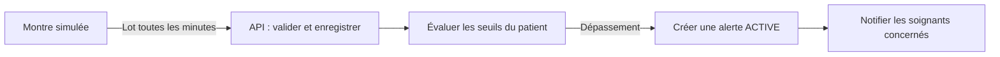
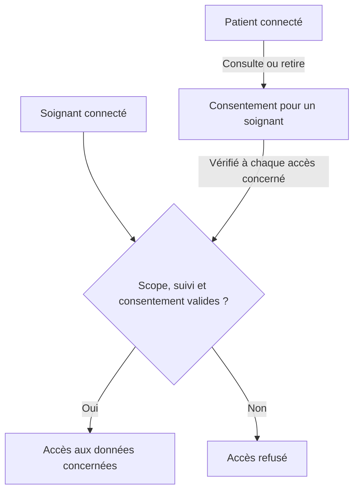

# Veillo — Télésuivi de patients

## 1. Présentation du projet

Veillo est le projet fil rouge du **Mastère 2 Web Services**, **sujet 6 : télésuivi de patients à domicile**. Un service hospitalier souhaite consulter les mesures de ses patients à distance et prévenir les soignants lorsqu’un seuil est dépassé.

Dans ce projet, les montres sont simulées et toutes les données de santé sont fictives. **Les parcours ci-dessous décrivent la cible fonctionnelle. L’implémentation est en cours ; son avancement est précisé plus bas.** Les sections TP présentent le travail réalisé et ses livrables.

### Les acteurs

- **Patient :** personne suivie à domicile. Il consulte ses consentements et peut retirer l’autorisation donnée à un soignant.
- **Soignant :** professionnel qui suit des patients, consulte leurs mesures et alertes selon ses droits, configure leurs seuils et marque les alertes prises en charge comme traitées.
- **Montre simulée :** client IoT qui produit des relevés fictifs de fréquence cardiaque, de SpO₂ et de pas, puis les transmet à l’API.

### Des mesures aux alertes

Toutes les minutes, le simulateur envoie un lot pour un patient à `POST /measurements`. Le lot contient `patientId`, un identifiant unique `batchId` et un tableau non vide `measurements`. Chaque relevé comprend un horodatage, une fréquence cardiaque, une SpO₂ et le nombre de pas depuis le relevé précédent.

L’API devra vérifier l’identité et les droits de l’émetteur, puis valider le lot entier. L’enregistrement est atomique : toutes les mesures sont enregistrées ou aucune. Un relevé invalide entraîne le rejet complet ; un `batchId` déjà enregistré donne `409`, même si son contenu est identique.

Les mesures seront comparées aux seuils applicables du patient. Chaque seuil définit un minimum et un maximum pour un type de mesure ; un seul seuil actif est autorisé par patient et par type. Un dépassement crée une alerte `ACTIVE`, liée à la mesure et au seuil concernés.



La notification push prévue contiendra un message générique, sans donnée de santé. Le soignant pourra ensuite consulter l’alerte dans un client externe et la passer de `ACTIVE` à `TRAITEE`. Les critères de sélection des destinataires restent à préciser.

Le sujet prévoit également un **webhook signé pour l’intégration IoT**. Son contrat et son articulation avec la notification push restent à définir ; aucun mécanisme de livraison n’est encore implémenté.

Les guides [Mesures](openapi/measurements/measurements-contract.md), [Seuils](openapi/thresholds/thresholds-contract.md) et [Alertes](openapi/alerts/alerts-contract.md) détaillent les JSON et les règles de chaque échange.

### Suivi, consentement et accès aux données

Dans le MCD, `SUIVRE` associe les soignants aux patients qu’ils accompagnent. Un patient peut être suivi par plusieurs soignants et inversement. Le **consentement** représente l’autorisation donnée par un patient à un soignant pour accéder à ses données ; il est distinct du suivi.

Le patient connecté consulte ses consentements avec `GET /patients/me/consents` et retire une autorisation avec `DELETE /patients/me/consents/{consentId}`. Le retrait bloque les accès futurs concernés tout en conservant le consentement, la trace du retrait, les mesures et leur historique.



Les principes d’accès retenus sont :

- **OAuth 2.0 avec JWT** : des jetons d’accès signés identifient l’appelant et portent ses permissions. Les scopes, distincts pour montre, patient et soignant, indiquent les opérations autorisées ; le backend devra aussi vérifier les droits sur chaque objet.
- Un soignant accède uniquement aux données de ses patients, avec un consentement valide à chaque accès concerné. Les collections restent limitées aux objets accessibles, quels que soient les filtres transmis.
- `401` signale une authentification absente ou invalide ; `403`, un rôle ou scope insuffisant ; `404`, un objet inexistant ou hors du périmètre autorisé.
- Les réponses contiennent uniquement les données nécessaires et les logs ne doivent contenir aucune donnée de santé.

Le détail du contrôle du consentement reste à harmoniser sur certaines opérations. Les décisions ouvertes sont recensées dans la [conception](docs/design.md#8-décisions-restant-à-clarifier). Le guide [Consentements](openapi/consents/consents-contract.md) précise les opérations du patient.

## 2. Équipe

- **Mehdy** : Conception globale, contrats API et backend Patients, Consentements et Seuils.
- **Ethan** : Backend Mesures, Alertes et Soignants, Docker et conteneurisation.
- **Elamine** : Cache HTTP, tests d’intégration et préparation de Schemathesis.
- **Egor** : IoT et développement du simulateur de montres connectées.

## 3. Architecture et technologies

Le simulateur IoT enverra ses mesures à l’API REST NestJS/TypeScript. L’API utilisera PostgreSQL pour les conserver. Une application mobile externe consommera l’API ; **aucun frontend mobile n’est à développer dans ce projet**. Les échanges et les contrats à préciser sont décrits dans [docs/design.md](docs/design.md).

  *Comprendre les composants, le modèle de données et les décisions de conception.*

Le backend utilise NestJS/TypeScript, TypeORM et PostgreSQL. Les [choix techniques](CHOIX_TECHNIQUES.md) expliquent ces technologies ; l’[environnement backend](backend/README.md#environnement-technique) précise les versions, dépendances et outils de test.

### Démarrer avec Docker

Copier [.env.example](.env.example) vers `.env` si nécessaire et renseigner `DB_PASSWORD`, puis lancer depuis la racine :

  *Identifier les variables de connexion et les ports à renseigner sur sa machine.*

```bash
docker compose up -d --build
```

Le backend utilise par défaut `http://localhost:3000` (`GET /` répond actuellement `404`). Ports, connexion et migrations : [Infrastructure Docker](docs/docker.md).

  *Retrouver les commandes Docker, les accès PostgreSQL et les précautions sur les migrations.*

### État actuel et prochaines étapes

**Conception disponible :** MCD, contrats OpenAPI, guides métier et mocks Prism. Certains formats JSON et arbitrages restent ouverts ; un mock ne prouve pas que les règles métier fonctionnent dans le backend.

**Code présent :** un socle NestJS/PostgreSQL et des traitements Mesures et Alertes. Le [guide backend](backend/README.md) précise les routes, les raccordements restants et les limites des tests. Vérifier l’historique SQL de chaque base avec le [guide Docker](docs/docker.md#migrations-typeorm).

**À terminer :** fonctionnalités Patients, Consentements et Seuils, simulateur, cache HTTP, notifications push et webhook signé. **OAuth 2.0/JWT et le raccordement des contrôles d’accès et de consentement aux routes restent à réaliser**, selon les [principes de sécurité](docs/design.md#7-sécurité).

  *Consulter les choix de sécurité et les modalités encore à définir.*

Des tests unitaires et HTTP sont présents. Leur existence ne prouve pas que tous les parcours fonctionnent avec PostgreSQL ni qu’ils respectent entièrement le contrat. Les [commandes de vérification](backend/README.md#build-et-tests) sont documentées dans le backend.

  *Lancer les vérifications du backend et comprendre les limites des suites de tests.*

## 4. Organisation du dépôt

Repères principaux (arborescence abrégée) :

```text
.
├── backend/                   # API NestJS, persistance et tests
├── bruno/                     # Exercices TP1 et requêtes du mock TP3
├── docs/
│   ├── tests/                 # Tests d’intégration et commandes de test
│   ├── images/                # MCD, MLD, MPD, diagramme REST et captures
│   ├── design.md              # Architecture, MCD et décisions
│   ├── api.md                 # Opérations et règles API
│   └── api-review.md          # Réponses HTTP et points ouverts
├── openapi/
│   ├── openapi.yaml           # Point d’entrée du contrat
│   ├── measurements/          # Mesures : opérations, composants et guide
│   ├── patients/              # Patients
│   ├── thresholds/            # Seuils
│   ├── alerts/                # Alertes
│   ├── consents/              # Consentements
│   ├── caregivers/            # Guide Soignant, sans endpoint dédié
│   ├── common/                # Définitions partagées
│   ├── security/              # Authentification
│   ├── cache/                 # Contrat du cache HTTP des seuils
│   ├── schemathesis/          # Tests contractuels : guide et configuration
│   ├── architecture-api.md    # Navigation et responsabilités
│   ├── bundle.md              # Génération du contrat regroupé
│   ├── spectral.md            # Lint et règles du contrat
│   ├── openapi.bundle.yaml    # Contrat regroupé, généré
│   └── .spectral.yaml         # Règles de validation
├── compose.yaml              # Backend et PostgreSQL
├── compose.migrations.yaml   # Outillage des migrations
├── CHOIX_TECHNIQUES.md
└── IA.md
```

### Où chercher ?

- [Conception et guides métier — TP2](#6-tp2--conception-de-lapi-rest)

  *Modèles de données, règles API et contrats de chaque ressource.*

- [Contrats et outillage — TP3](#7-tp3--contrat-openapi)

  *Sources YAML, architecture modulaire, validation et mock Prism.*

- [Développement et infrastructure — TP4](#8-tp4--implémentation-de-lapi-rest)

  *Couches NestJS, lancement, PostgreSQL et migrations.*

- [Tests — TP5](#9-tp5--tests-dintégration-et-schemathesis)

  *Suites existantes et préparation de Schemathesis.*

- [Cache HTTP — TP6](#10-tp6--cache-http-des-seuils)

  *Contrat des préconditions et espace de développement.*

## 5. TP1 — Initialisation et découverte HTTP

Le TP1 a permis d’apprendre à utiliser une API externe et à comprendre les échanges HTTP avec curl et Bruno.

- [Exploration HTTP](docs/http.md)

  *Exercices et notions abordées pour comprendre les échanges HTTP.*

- [Collection Bruno](bruno/)

  *Requêtes et assertions sur httpbin et HAPI FHIR pour reproduire les exercices.*

- [Utilisation de l’IA](IA.md)

  *Contributions déclarées et limites de l’assistance utilisée dans le projet.*

## 6. TP2 — Conception de l'API REST

### Conception et modèles de données

- [Conception du projet](docs/design.md) : architecture, relations métier et décisions ouvertes à consulter avant de développer.
- [MCD — Modèle conceptuel](docs/images/Modele%20Conceptuel%20de%20Donn%C3%A9e%20MCD-veillo.png) : entités, associations et cardinalités pour comprendre les liens métier.
- [MLD — Modèle logique](docs/images/Sch%C3%A9ma%20relationnel%20MLD%20%E2%80%94%20Veillo.png) : modèle relationnel à consulter pour préparer les relations entre les tables.
- [MPD — Modèle physique](docs/images/Sch%C3%A9ma%20MPD%20relationnel%20Veillo.png) : structure SQL de référence pour préparer les migrations PostgreSQL.
- [Diagramme REST](docs/design.md#5-modèle-de-ressources-rest) : vue des ressources et de leurs relations HTTP.

### Règles API et guides métier

- [Opérations API](docs/api.md) : routes, méthodes et comportements attendus pour retrouver une opération.
- [Réponses HTTP](docs/api-review.md) : justification des codes de réponse et points encore à valider.
- [Mesures](openapi/measurements/measurements-contract.md) : JSON des lots IoT, consultation, atomicité et doublons ; point d’entrée pour le simulateur.
- [Patients](openapi/patients/patients-contract.md) : consultation des patients accessibles et données attendues, dont le JSON reste à préciser.
- [Alertes](openapi/alerts/alerts-contract.md) : liste, détail et traitement d’une alerte, avec les décisions encore ouvertes.
- [Consentements](openapi/consents/consents-contract.md) : consultation et retrait par le patient, effets du retrait et contrat JSON à compléter.
- [Seuils](openapi/thresholds/thresholds-contract.md) : JSON de création et de modification, bornes, unicité et préconditions HTTP.
- [Soignants](openapi/caregivers/caregivers-contract.md) : rôle dans le suivi et les accès ; justification de l’absence d’endpoint dédié en V1.

## 7. TP3 — Contrat OpenAPI

- [Architecture des contrats](openapi/architecture-api.md)

  *Comprendre l’organisation des YAML OpenAPI et savoir quel fichier modifier.*

- [Contrat OpenAPI — fichier parent](openapi/openapi.yaml) : point d’entrée qui relie les opérations et leurs composants ; commencer ici pour parcourir les sources.
- [Bundle OpenAPI](openapi/bundle.md)

  *Générer et mettre à jour le contrat consolidé.*

- [Outillage TP3](docs/outillage-tp3.md) : parcours des outils, prérequis et commandes Redocly, Prism et Bruno.
- [Spectral](openapi/spectral.md)

  *Vérifier la conformité du contrat OpenAPI aux règles de lint.*

- [Guide du mock Prism](docs/mock-prism.md) : scénarios, résultats observés et limites pour tester sans backend.
- [Requêtes Bruno du mock](bruno/tp3-mock/) : appels HTTP et assertions à exécuter une fois Prism lancé.
- [Environnement Bruno du mock](bruno/environments/mock.bru) : variables à sélectionner pour envoyer les requêtes vers Prism.
- [Documentation HTML Redocly](docs/index.html) : sortie encore vide, à générer avec les commandes du guide d’outillage.

Validation : `openapi.yaml → Redocly (bundle) → openapi.bundle.yaml → Spectral`

Mock : `openapi.yaml → Prism → Bruno`

## 8. TP4 — Implémentation de l'API REST

Le TP4 porte sur l’implémentation du backend NestJS à partir du contrat OpenAPI et des règles métier définies.

- **Conception technique du backend** : [architecture-backend.md](backend/architecture-backend.md)

  *Comprendre l’organisation du backend, les responsabilités de chaque couche et les conventions de développement.*

- [Choix techniques](CHOIX_TECHNIQUES.md)

  *Comprendre pourquoi NestJS, TypeScript, TypeORM et OpenAPI sont utilisés dans Veillo.*

- [Guide backend](backend/README.md)

  *Démarrer le backend, utiliser ses outils et lancer les vérifications.*

- [Docker et migrations TypeORM](docs/docker.md) : démarrage, logs, accès PostgreSQL et commandes de migration, avec les précautions sur les données.

Les [routes et traitements présents](backend/README.md#routes-et-traitements-présents) sont recensés dans le backend. Ses sections détaillent aussi les [erreurs HTTP](backend/README.md#erreurs-http), la [validation des réponses](backend/README.md#validation-openapi-des-réponses) et la [pagination encore à valider](backend/README.md#pagination).

## 9. TP5 — Tests d’intégration et Schemathesis

- [Guide des tests d’intégration](docs/tests/integration-testing.md)

  *Écrire les tests métier, isoler leurs données et lancer la suite d’intégration.*

- [Tests contractuels — Schemathesis](openapi/schemathesis/schemathesis.md)

  *Préparation des tests de contrat pour Elamine ; distingue les essais Prism, le backend et la CI prévue.*

- [Tests HTTP du socle](backend/test/e2e/)

  *Suites existantes pour vérifier les échanges HTTP et les mécanismes transversaux.*

- [Tests unitaires des ressources](backend/test/unit/features/)

  *Tests isolés des DTO, Controllers et Services, organisés comme le code source.*

- [Tests d’intégration](backend/test/integration/)

  *Tests d’assemblage et d’outillage ; les scénarios métier avec persistance restent à développer.*

- [**Commandes de test**](docs/tests/test-commands.md)

  *Retrouver les commandes pour exécuter les différentes suites de tests.*

Les tests d’intégration métier et le workflow CI restent à développer.

## 10. TP6 — Cache HTTP des seuils

Le contrat des requêtes conditionnelles est défini ; son implémentation reste à réaliser.

- [Contrat du cache HTTP](openapi/cache/cache-contract.md)

  *ETag, préconditions, réponses `304/412/428` et précautions d’accès aux données.*

- [Composants OpenAPI du cache](openapi/cache/components/)

  *Paramètres, en-têtes, réponses et exemples partagés à consulter pour faire évoluer ce contrat.*

- [Opérations Seuils](openapi/thresholds/paths/seuils.yaml)

  *Références du cache dans les opérations HTTP concernées.*

- [Guide d’implémentation du cache](backend/src/common/cache/cache-implementation.md)

  *Repérer les fichiers à compléter, les tests et le raccordement aux Controllers et Services.*
