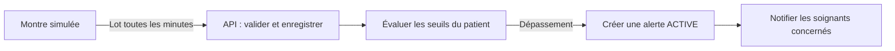
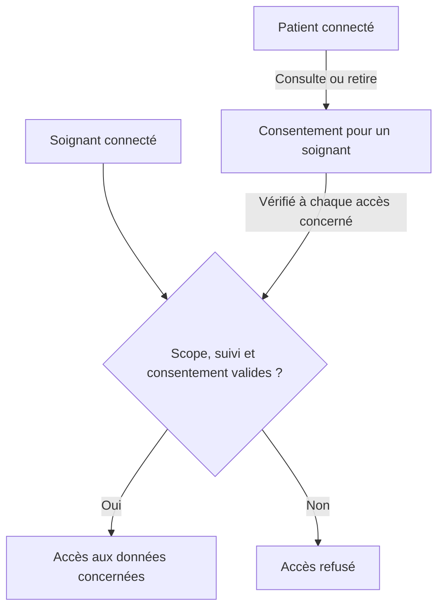

# Veillo — Télésuivi de patients

## 1. Présentation du projet

Veillo est le projet fil rouge du **Mastère 2 Web Services**, **sujet 6 : télésuivi de patients à domicile**. Un service hospitalier souhaite consulter les mesures de ses patients à distance et prévenir les soignants lorsqu’un seuil est dépassé.

Dans ce projet, les montres sont simulées et toutes les données de santé sont fictives. **Les parcours ci-dessous décrivent le fonctionnement prévu : les fonctionnalités métier restent à implémenter.** Les sections TP présentent le travail réalisé et ses livrables.

### Les acteurs

- **Patient :** personne suivie à domicile. Il consulte ses consentements et peut retirer l’autorisation donnée à un soignant.
- **Soignant :** professionnel qui suit des patients, consulte leurs mesures et alertes selon ses droits, configure leurs seuils et marque les alertes prises en charge comme traitées.
- **Montre simulée :** client IoT qui produit des relevés fictifs de fréquence cardiaque, de SpO₂ et de pas, puis les transmet à l’API.

### Des mesures aux alertes

Toutes les minutes, le simulateur envoie un lot pour un patient à `POST /measurements`. Le lot contient `patientId`, un identifiant unique `batchId` et un tableau non vide `measurements`. Chaque relevé comprend un horodatage, une fréquence cardiaque, une SpO₂ et le nombre de pas depuis le relevé précédent.

L’API devra vérifier l’identité et les droits de l’émetteur, puis valider le lot entier. L’enregistrement est atomique : toutes les mesures sont enregistrées ou aucune. Un relevé invalide entraîne le rejet complet ; un `batchId` déjà enregistré donne `409`, même si son contenu est identique.

Les mesures seront comparées aux seuils applicables du patient. Chaque seuil définit un minimum et un maximum pour un type de mesure ; un seul seuil actif est autorisé par patient et par type. Un dépassement crée une alerte `ACTIVE`, liée à la mesure et au seuil concernés.



La notification push prévue contiendra un message générique, sans donnée de santé. Le soignant pourra ensuite consulter l’alerte dans un client externe et la passer de `ACTIVE` à `TRAITEE`. Les critères de sélection des destinataires restent à préciser.

Le sujet prévoit également un **webhook signé pour l’intégration IoT**. Son contrat et son articulation avec la notification push restent à définir ; aucun mécanisme de livraison n’est encore implémenté.

Les échanges JSON sont détaillés dans les guides [Mesures](openapi/measurements/guide.md), [Seuils](openapi/thresholds/guide.md) et [Alertes](openapi/alerts/guide.md).

### Suivi, consentement et accès aux données

Dans le MCD, `SUIVRE` associe les soignants aux patients qu’ils accompagnent. Un patient peut être suivi par plusieurs soignants et inversement. Le **consentement** représente l’autorisation donnée par un patient à un soignant pour accéder à ses données ; il est distinct du suivi.

Le patient connecté consulte ses consentements avec `GET /patients/me/consents` et retire une autorisation avec `DELETE /patients/me/consents/{consentId}`. Le retrait bloque les accès futurs concernés tout en conservant le consentement, la trace du retrait, les mesures et leur historique.



Les principes d’accès retenus sont :

- **OAuth 2.0 avec JWT** : des jetons d’accès signés identifient l’appelant et portent ses permissions. Les scopes, distincts pour montre, patient et soignant, indiquent les opérations autorisées ; le backend devra aussi vérifier les droits sur chaque objet.
- Un soignant accède uniquement aux données de ses patients, avec un consentement valide à chaque accès concerné. Les collections restent limitées aux objets accessibles, quels que soient les filtres transmis.
- `401` signale une authentification absente ou invalide ; `403`, un rôle ou scope insuffisant ; `404`, un objet inexistant ou hors du périmètre autorisé.
- Les réponses contiennent uniquement les données nécessaires et les logs ne doivent contenir aucune donnée de santé.

Le détail du contrôle du consentement reste à harmoniser sur certaines opérations. Les formats JSON encore ouverts, les modalités OAuth et les autres décisions à valider sont recensés dans la [conception](docs/design.md#8-décisions-restant-à-clarifier). Le guide [Consentements](openapi/consents/guide.md) précise les deux opérations du patient.

## 2. Équipe

- **Mehdy** : Architecture globale, contrats API et développement du backend NestJS/TypeScript.
- **Ethan** : Docker et conteneurisation.
- **Elamine** : Tests d'intégration.
- **Egor** : IoT et développement du simulateur de montres connectées.

## 3. Architecture et technologies

Le simulateur IoT enverra ses mesures à l’API REST NestJS/TypeScript. L’API utilisera PostgreSQL pour les conserver. Une application mobile externe consommera l’API ; **aucun frontend mobile n’est à développer dans ce projet**. Les échanges et les contrats à préciser sont décrits dans [docs/design.md](docs/design.md).

Technologies présentes, selon [backend/package.json](backend/package.json) :

- **Node.js `22.x` et npm** ([backend/.nvmrc](backend/.nvmrc) indique `22`).
- **NestJS `^11.0.1`**, avec Express, et **TypeScript `^5.7.3`**.
- **Jest `^30.0.0` et Supertest `^7.0.0`** pour les tests.
- **ESLint `^9.18.0` et Prettier `^3.4.2`** pour la qualité du code.
- **TypeORM et le pilote PostgreSQL `pg`**, ainsi que `class-validator` et `class-transformer` pour la validation des DTO.
- Dépendances complémentaires : `reflect-metadata` (`^0.2.2`) et RxJS (`^7.8.1`).

Ces versions sont les contraintes déclarées, pas un relevé des versions installées. [backend/package-lock.json](backend/package-lock.json) verrouille les dépendances utilisées par `npm ci`.

### Démarrer avec Docker

Copier [.env.example](.env.example) vers `.env` si nécessaire et renseigner `DB_PASSWORD`, puis lancer depuis la racine :

```bash
docker compose up -d --build
```

Le backend utilise par défaut `http://localhost:3000` (`GET /` répond actuellement `404`). Ports, connexion et migrations : [Infrastructure Docker](docs/docker.md).

### État actuel et prochaines étapes

**Conception disponible :** MCD, contrats OpenAPI, guides métier et mocks Prism. Certains formats JSON et arbitrages restent ouverts ; un mock ne prouve pas que les règles métier fonctionnent dans le backend.

**Socle préparé :** serveur NestJS avec six modules, Controllers et Services préparatoires, validation globale, connexion PostgreSQL via TypeORM et Docker Compose. Aucune Entity métier n’est encore enregistrée. Les migrations Patients, Seuils et Consentements contiennent leur SQL ; les trois autres restent à compléter. L’application des migrations se vérifie sur chaque base avec le [guide Docker](docs/docker.md#migrations-typeorm).

**À implémenter :** simulateur, réception et stockage des lots, consultations, seuils, alertes, consentements, notifications et webhook signé. **OAuth 2.0/JWT et les contrôles d’accès restent à intégrer**, selon les [principes de sécurité](docs/design.md#7-sécurité).

## 4. Organisation du dépôt

Repères principaux (arborescence abrégée) :

```text
.
├── backend/                   # API NestJS, persistance et tests
├── bruno/                     # Exercices TP1 et requêtes du mock TP3
├── docs/
│   ├── tests/                 # Guide de préparation Schemathesis
│   ├── images/                # MCD, MLD, MPD, diagramme REST et captures
│   ├── design.md              # Architecture, MCD et décisions
│   ├── api.md                 # Opérations et règles API
│   └── api-review.md          # Réponses HTTP et points ouverts
├── openapi/
│   ├── openapi.yaml           # Point d’entrée du contrat
│   ├── measurements/          # Mesures : opérations, composants et guide
│   ├── patients/              # Patients
│   ├── thresholds/            # Seuils
│   ├── alerts/                # Alertes
│   ├── consents/              # Consentements
│   ├── caregivers/            # Guide Soignant, sans endpoint dédié
│   ├── common/                # Définitions partagées
│   ├── security/              # Authentification
│   ├── cache/                 # Contrat du cache HTTP des seuils
│   ├── architecture-api.md    # Navigation et responsabilités
│   ├── openapi.bundle.yaml    # Contrat regroupé, généré
│   └── .spectral.yaml         # Règles de validation
├── compose.yaml              # Backend et PostgreSQL
├── compose.migrations.yaml   # Outillage des migrations
├── CHOIX_TECHNIQUES.md
└── IA.md
```

- **Backend :** les six ressources sont dans [backend/src/features/](backend/src/features/), les migrations dans [backend/src/persistence/migrations/](backend/src/persistence/migrations/) et les tests HTTP dans [backend/test/e2e/](backend/test/e2e/). Le dossier [backend/test/integration/](backend/test/integration/) ne contient pas encore de tests métier.
- **Documentation :** chaque ressource dans [openapi/](openapi/) possède son guide métier ; [docs/tests/](docs/tests/) prépare les tests et [docs/images/](docs/images/) conserve les modèles et captures.
- **Sources OpenAPI :** le [fichier parent](openapi/openapi.yaml) référence les opérations et composants classés par ressource. Les définitions transversales sont dans `common/`, `security/` et `cache/`. Le [guide d’architecture](openapi/architecture-api.md) explique où intervenir ; le [bundle](openapi/openapi.bundle.yaml) est généré.
- **Infrastructure :** [compose.yaml](compose.yaml) et [compose.migrations.yaml](compose.migrations.yaml) sont expliqués dans le [guide Docker](docs/docker.md). Les contributions de l’IA sont déclarées dans [IA.md](IA.md).

## 5. TP1 — Initialisation et découverte HTTP

Le TP1 a permis d’apprendre à utiliser une API externe et à comprendre les échanges HTTP avec curl et Bruno.

- [docs/http.md](docs/http.md) : exercices réalisés et notions HTTP abordées.
- [bruno/](bruno/) : requêtes réalisées pour tester les API externes httpbin et HAPI FHIR.
- [IA.md](IA.md) : déclaration de l’utilisation de l’IA.

## 6. TP2 — Conception de l'API REST

Les livrables du TP2 sont :

- **Endpoints et méthodes HTTP** : [docs/api.md](docs/api.md)
- **Réponses HTTP** : [docs/api-review.md](docs/api-review.md)
- **Architecture et MCD source** : [docs/design.md](docs/design.md)
- **Diagramme REST** : [Voir le diagramme REST de Veillo](docs/design.md#5-modèle-de-ressources-rest)
- **MCD — Conception de la base de données** : [Voir le MCD de Veillo](docs/images/Modele%20Conceptuel%20de%20Donn%C3%A9e%20MCD-veillo.png)
- **MLD — Modèle logique des données** : [Voir le MLD de Veillo](docs/images/Sch%C3%A9ma%20relationnel%20MLD%20%E2%80%94%20Veillo.png)
- **MPD — Modèle physique des données** : [Voir le MPD de Veillo](docs/images/Sch%C3%A9ma%20MPD%20relationnel%20Veillo.png)

Guides métier : [Mesures](openapi/measurements/guide.md), [Patients](openapi/patients/guide.md), [Alertes](openapi/alerts/guide.md), [Consentements](openapi/consents/guide.md), [Seuils](openapi/thresholds/guide.md) et [Soignant](openapi/caregivers/guide.md).

Consigne complémentaire du support de cours : fonction principale `nommerRessourcePilote`, référence à la note interne **NC-102**. Cette mention ne correspond pas à une fonction actuellement implémentée ; la nécessité de son implémentation reste à vérifier dans le support.

## 7. TP3 — Contrat OpenAPI

Les livrables du TP3 sont :

- **Contrat OpenAPI** : [fichier parent](openapi/openapi.yaml) et [architecture par ressource](openapi/architecture-api.md)
- **Bundle généré** : [openapi/openapi.bundle.yaml](openapi/openapi.bundle.yaml)
- **Organisation et commandes des outils** : [docs/outillage-tp3.md](docs/outillage-tp3.md)
- **Règles Spectral** : [openapi/.spectral.yaml](openapi/.spectral.yaml)
- **Mock Prism** : [docs/mock-prism.md](docs/mock-prism.md), [requêtes Bruno](bruno/tp3-mock/) et [environnement du mock](bruno/environments/mock.bru)
- **Documentation HTML Redocly** : [docs/index.html](docs/index.html) — fichier encore vide, à générer selon le guide d’outillage

Flux : `openapi.yaml → Spectral → Prism → Bruno`

## 8. TP4 — Implémentation de l'API REST

Le TP4 porte sur l’implémentation du backend NestJS à partir du contrat OpenAPI et des règles métier définies.

- **Choix techniques** : [CHOIX_TECHNIQUES.md](CHOIX_TECHNIQUES.md)
- **Organisation et commandes du backend** : [backend/README.md](backend/README.md)
- **Docker et migrations TypeORM** : [docs/docker.md](docs/docker.md)

### Avancement — Mesures, Alertes et Soignants

- **Endpoints implémentés** : `POST /measurements`, `GET /patients/{patientId}/measurements`, `GET /alerts`, `GET /alerts/{alertId}` et `PATCH /alerts/{alertId}` (avec la couche métier `caregivers` sans route dédiée en V1, conformément à [docs/contrats/soignant.md](docs/contrats/soignant.md)).
- **Erreurs normalisées RFC 9457** : un gestionnaire global ([problem-details.filter.ts](backend/src/common/http/problem-details.filter.ts)) renvoie `application/problem+json` avec une URI `type` stable par catégorie (`validation`, `not-found`, `conflict`, `internal-error`), le champ `errors` sur les erreurs de validation `400`, et consigne les traces `500` côté logs sans les exposer dans la réponse HTTP. L’authentification OAuth/JWT sera branchée une fois le contrat OpenAPI correspondant validé.
- **Justification de la pagination (offset)** : les collections paginées (`GET /patients/{patientId}/measurements` et `GET /alerts`) utilisent une pagination par **offset** (`page` à partir de `0`, `size` par défaut à `50` et plafonné à `100`, au-delà `400`). Ce choix correspond directement aux paramètres `page` et `size` fixés dans le contrat OpenAPI, permet d’afficher le nombre total de pages (`totalPages`) et d’accéder directement à une page donnée côté client, tout en restant maîtrisé grâce au plafond de 100 éléments et à un tri déterministe (`horodatage DESC, id ASC`). Chaque réponse inclut un objet `links` (`self`, `next`, `prev`) conservant les filtres actifs pour naviguer vers la page suivante ou précédente.

## 9. TP5 — Tests d’intégration et Schemathesis

Le travail est préparé dans le [guide Schemathesis pour Elamine](docs/tests/schemathesis.md). Il distingue les essais sur Prism des vérifications futures du backend et de la CI.

- **Tests HTTP du socle** : [backend/test/e2e/](backend/test/e2e/)
- **Emplacement des tests d’intégration métier** : [backend/test/integration/](backend/test/integration/), encore vide

Les tests métier et le workflow CI restent à développer.

## 10. TP6 — Cache HTTP des seuils

Le contrat des requêtes conditionnelles est défini ; son implémentation reste à réaliser.

- **Guide central du cache HTTP** : [openapi/cache/guide.md](openapi/cache/guide.md)
- **Composants du cache** : [openapi/cache/components/](openapi/cache/components/)
- **Opérations concernées** : [openapi/thresholds/paths/seuils.yaml](openapi/thresholds/paths/seuils.yaml)
- **Espace de travail et tests à compléter** : [backend/src/common/cache/](backend/src/common/cache/), avec son [guide de développement](backend/src/common/cache/README.md)
