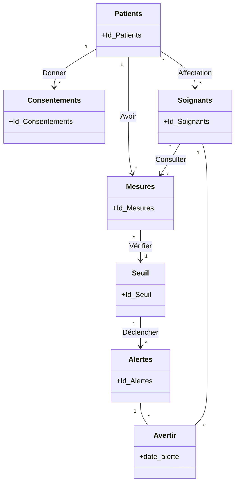

# Conception — Télésuivi patient (montres connectées)

Projet M2 Web Services, sujet 6.

Ce document présente le modèle conceptuel de données (MCD) que nous avons retenu et ce qu'il implique pour le développement du backend. Le backend n'est pas encore développé : tout ce qui est décrit ici relève de la conception.

Nous utilisons deux repères pour distinguer ce que le MCD décrit de ce qu'il restera à coder : **[MCD]** pour ce que le modèle représente directement, **[Backend]** pour les comportements à implémenter.

## 1. Présentation du projet

Le projet porte sur le suivi à distance de patients équipés de montres connectées. Les montres envoient trois types de données : la fréquence cardiaque, la saturation en oxygène (SpO₂) et le nombre de pas.

Les mesures sont comparées à des seuils. Lorsqu'un dépassement est détecté, une alerte est créée et les soignants concernés sont avertis.

Les soignants peuvent consulter les mesures des patients qu'ils suivent, à condition que le patient ait donné son consentement. Le sujet impose aussi des contraintes de sécurité, détaillées en section 7.

### Ce qui est validé et ce qui ne l'est pas

| Validé par le groupe | Pas encore décidé |
|---|---|
| Les six entités, les sept associations et leurs cardinalités (sections 2 et 3). | Les attributs métier, hors identifiants et `date_alerte`. |
| L'absence d'entité `Utilisateurs`. | Le rôle de `Consulter`, la représentation du consentement et de son retrait. |
| Les trois types de mesures et l'envoi d'un lot par minute (exigences du sujet). | Les règles de seuil et d'alerte, les scopes OAuth, le contrat de l'API. |
| L'acquittement des alertes est individuel pour chaque soignant. | Les attributs qui représentent cet acquittement. |
| Aucun historique des révocations de consentement n'est conservé. | La façon de représenter un consentement révoqué. |

Tout ce qui figure dans la colonne de droite est présenté comme une question ou une proposition, jamais comme une décision.

## 2. Modèle conceptuel de données

Notre MCD comporte six entités. Nous n'avons pas prévu d'entité `Utilisateurs` : les patients et les soignants sont deux entités distinctes.

| Entité        | Rôle                                                                                                 |
| ------------- | ---------------------------------------------------------------------------------------------------- |
| Patients      | Personnes suivies grâce à une montre connectée.                                                      |
| Soignants     | Professionnels de santé qui suivent des patients, consultent leurs mesures et reçoivent les alertes. |
| Consentements | Consentements donnés par les patients.                                                               |
| Mesures       | Données de santé envoyées par les montres.                                                           |
| Seuil         | Valeurs de référence auxquelles les mesures sont comparées.                                          |
| Alertes       | Alertes créées à partir d'un seuil.                                                                  |

### Diagramme du modèle conceptuel de données



Ce diagramme est une représentation UML simplifiée du MCD. Le tableau de la section 3 reste la référence pour les cardinalités exactes. `Avertir` y apparaît comme une classe, mais c'est une association entre `Soignants` et `Alertes`, qui porte l'attribut `date_alerte` : ce n'est pas une septième entité.

### Dictionnaire de données

Seuls les attributs définis dans le MCD sont validés : les identifiants (`Id_Patients`, `Id_Soignants`, `Id_Consentements`, `Id_Mesures`, `Id_Seuil`, `Id_Alertes`) et `date_alerte`, portée par l'association `Avertir`.

Le tableau suivant liste, pour chaque entité, des attributs que nous pourrions ajouter. **Ce sont des propositions à valider, pas des décisions.** Elles s'appuient sur le sujet et sur les besoins décrits dans ce document.

| Entité        | Attributs proposés (à valider)                                                                   | Besoin auquel ils répondent |
|---------------|--------------------------------------------------------------------------------------------------|-----------------------------|
| Patients      | identité du patient (nom, prénom, etc.)                                                          | Identifier la personne suivie. |
| Soignants     | identité du soignant (nom, prénom, etc.)                                                         | Identifier le professionnel. |
| Consentements | à étudier : statut (valide ou révoqué), date d'octroi (voir section 6)                           | Vérifier et révoquer un consentement. |
| Mesures       | type de mesure (fréquence cardiaque, SpO₂, pas), valeur, date et heure de la mesure              | Les trois données du sujet ; comparaison aux seuils. |
| Seuil         | type de mesure concerné, borne(s) de dépassement                                                 | Détecter un dépassement. |
| Alertes       | à étudier : date de création                                                                     | Situer l'alerte dans le temps. La date d'avertissement existe déjà (`date_alerte`). |

Les types, formats et contraintes (obligatoire, unique, unité) de ces attributs ne sont pas non plus définis.

Deux décisions du groupe laissent des attributs à définir :

- **Acquittement individuel des alertes.** L'acquittement concerne un couple soignant-alerte, donc l'association `Avertir`, et non l'entité `Alertes`. `Avertir` ne porte aujourd'hui que `date_alerte` : l'attribut qui représentera l'acquittement (par exemple son état ou sa date) reste à définir.
- **Aucun historique des révocations.** Le MCD ne montre aucun attribut du consentement permettant de dire qu'il est révoqué. L'attribut éventuel (ou un autre moyen) reste à définir (section 6).

## 3. Associations et cardinalités

Le MCD compte sept associations.

| Entité A  | Cardinalité | Association | Cardinalité | Entité B      |
| --------- | ----------- | ----------- | ----------- | ------------- |
| Patients  | 0,N         | Affectation | 0,N         | Soignants     |
| Patients  | 0,N         | Donner      | 1,1         | Consentements |
| Patients  | 0,N         | Avoir       | 1,1         | Mesures       |
| Soignants | 0,N         | Consulter   | 0,N         | Mesures       |
| Mesures   | 1,1         | Vérifier    | 0,N         | Seuil         |
| Seuil     | 0,N         | Déclencher  | 1,1         | Alertes       |
| Soignants | 0,N         | Avertir     | 0,N         | Alertes       |

L'association `Avertir` porte l'attribut `date_alerte`. Les autres n'ont pas d'attribut.

Voici comment nous lisons ces cardinalités :

- **Affectation** : un patient peut être suivi par plusieurs soignants, et un soignant peut suivre plusieurs patients.
- **Donner** : un consentement appartient à un seul patient, qui peut en donner plusieurs.
- **Avoir** : une mesure appartient à un seul patient, qui peut avoir de nombreuses mesures.
- **Consulter** : un soignant peut être associé à plusieurs mesures, et une mesure peut être associée à plusieurs soignants. La nature de cette association (droit ou historique de consultation) reste à définir (section 5).
- **Vérifier** : une mesure est rattachée à un seul seuil, qui peut servir pour plusieurs mesures.
- **Déclencher** : une alerte est déclenchée par un seul seuil, qui peut déclencher plusieurs alertes.
- **Avertir** : une alerte peut avertir plusieurs soignants, et un soignant peut être averti de plusieurs alertes.

## 4. Fonctionnement du télésuivi

Le parcours d'une mesure se lit directement dans le MCD **[MCD]** :

```text
Patient --Avoir--> Mesure --Vérifier--> Seuil --Déclencher--> Alerte --Avertir--> Soignant
```

Une mesure appartient à un patient et est rattachée à un seuil. Un seuil peut déclencher des alertes, et chaque alerte avertit des soignants à une date donnée (`date_alerte`).

### Acquittement des alertes

L'acquittement d'une alerte est **individuel** : chaque soignant averti acquitte l'alerte pour lui-même. L'acquittement d'un soignant ne change rien pour les autres soignants avertis de la même alerte.

Dans le MCD, le lien entre un soignant et une alerte est l'association `Avertir`, qui ne porte que `date_alerte`. L'attribut qui représentera l'acquittement reste donc à définir (section 2).

### Limite actuelle : le lien entre une alerte et sa mesure

Le MCD n'a pas d'association entre `Mesures` et `Alertes`. Une alerte est liée à un seuil par `Déclencher`, mais pas à la mesure qui l'a provoquée.

Quand plusieurs mesures sont rattachées au même seuil, on ne peut donc pas retrouver avec certitude laquelle a déclenché une alerte. Par exemple, si dix mesures dépassent le même seuil, les alertes associées à ce seuil ne disent pas de quelle mesure elles proviennent.

Nous ne modifions pas le modèle sans validation. Nous devons d'abord décider si cette traçabilité est nécessaire pour le projet (point 4 de la section 9).

### Ce que le backend devra faire **[Backend]**

Les montres connectées transmettent un lot de mesures toutes les minutes, conformément au sujet. Le backend devra :

- recevoir ces lots et traiter les mesures ;
- comparer chaque mesure à son seuil ;
- décider de créer ou non une alerte ;
- choisir les soignants à avertir et enregistrer `date_alerte` ;
- enregistrer l'acquittement de chaque soignant séparément ;
- envoyer la notification : le MCD enregistre seulement l'avertissement.

Les règles précises de ces étapes ne sont pas encore fixées (section 9).

## 5. Consultation des mesures

Le MCD relie les soignants aux mesures par `Consulter` (0,N de chaque côté), et les patients aux soignants par `Affectation` **[MCD]**. `Consulter` est une association plusieurs-à-plusieurs sans attribut. Elle relie un soignant et une mesure, mais le MCD ne dit pas ce que ce lien signifie. Nous n'avons pas tranché entre deux interprétations :

| | Autorisation de consultation | Historique de consultation |
|---|---|---|
| Sens du lien | Le soignant est autorisé à consulter cette mesure. | Le soignant a effectivement consulté cette mesure. |
| Limite avec le modèle actuel | Les droits dépendent déjà d'`Affectation` : le lien pourrait faire double emploi. | Pas de date, et impossible de distinguer plusieurs consultations d'une même mesure par le même soignant. |

Le choix dépend de ce que le groupe attend de cette association. Il reste à faire (point 5 de la section 9).

Dans tous les cas, deux règles s'appliquent **[Backend]** :

- un soignant ne consulte que les mesures des patients auxquels il est affecté ;
- le consentement du patient est vérifié avant chaque consultation.

## 6. Consentement

Le MCD indique qu'un patient donne des consentements et que chacun appartient à un seul patient **[MCD]**. Il ne montre aucun attribut permettant de représenter la validité, l'expiration ou le retrait d'un consentement.

### Ce que le sujet impose

- Le consentement est vérifié à chaque accès aux données d'un patient.
- Le consentement peut être retiré. Une fois retiré, un soignant ne doit plus accéder aux données du patient.

### Décision du groupe : pas d'historique des révocations

Aucun historique des révocations n'est conservé. Le système sait seulement si le consentement d'un patient est valide ou non à un instant donné : il ne garde pas la liste des consentements donnés puis révoqués. Conséquence : on ne pourra pas retrouver a posteriori à quelle date un patient a révoqué un consentement antérieur.

Le MCD ne dit pas comment représenter un consentement révoqué (par exemple un statut sur le consentement, ou sa suppression). Ce point reste à définir.

### Ce qui reste à décider

Ces points ne sont pas dans le sujet. Ce sont des choix fonctionnels ou techniques qui appartiennent au groupe.

| Question | Nature | Statut |
|---|---|---|
| Qu'est-ce qu'un consentement valide (donné, non retiré) ? | Fonctionnel | À définir |
| Un consentement expire-t-il, et au bout de combien de temps ? | Fonctionnel | À définir : le sujet ne parle pas d'expiration. |
| Un consentement s'applique-t-il à un soignant précis, à tous les soignants du patient, ou à certaines données ? | Fonctionnel | À définir. |
| Que signifie le fait de pouvoir avoir plusieurs consentements (par finalité, par période) ? | Fonctionnel | À définir. |
| Comment représenter un consentement révoqué, sans conserver d'historique des révocations ? | Technique | À définir, avec les attributs de la section 2. |
| Que devient l'accès aux mesures déjà reçues avant le retrait ? | Fonctionnel | À définir. |

## 7. Sécurité

Le MCD ne représente pas ces contraintes : elles concernent le comportement du backend **[Backend]**. Les quatre premières viennent du sujet.

**OAuth avec des scopes distincts.** OAuth sert à identifier l'appelant (une montre, un soignant) et à limiter ce qu'il peut faire grâce aux scopes. Les scopes sont distincts selon les usages, par exemple l'envoi de mesures par les montres et la lecture des mesures par les soignants. Leur liste n'est pas définie (point 8 de la section 9).

**Les scopes ne suffisent pas.** Un scope dit quel type d'action est permis, pas sur quels patients. Chaque accès à des données de patient passe donc par trois contrôles successifs :

1. le jeton OAuth est valide et son scope autorise l'action ;
2. le soignant est affecté au patient (association `Affectation`) ;
3. le patient a un consentement valide (section 6).

L'identité OAuth d'un patient ou d'un soignant doit être reliée à son entité. Sans entité `Utilisateurs`, la façon de le faire reste à définir (point 7 de la section 9).

**Consentement vérifié à chaque accès.** Chaque requête qui touche aux données d'un patient vérifie le consentement. Un contrôle fait une seule fois, à l'ouverture d'une session, ne suffirait pas : un retrait doit prendre effet immédiatement.

**Minimisation des réponses.** L'API renvoie seulement les données nécessaires à celui qui les demande, par exemple les champs utiles à un soignant plutôt que toute la fiche d'un patient. Le détail dépend du contrat d'API (section 8).

**Aucune donnée de santé dans les logs.** Les logs ne contiennent ni mesures ni autres informations de santé. Cela concerne aussi les messages d'erreur, les traces d'exceptions et un éventuel affichage du contenu des requêtes.

## 8. API REST

Le groupe a défini 12 endpoints, mais leur tableau n'existe pas dans le dépôt. Cette documentation ne définit donc aucun contrat d'API : ni routes, ni formats, ni scopes par endpoint. Les passages sur l'API décrivent seulement les comportements attendus du backend.

Dès que le tableau sera dans le dépôt, il faudra vérifier que chaque endpoint respecte les trois contrôles de la section 7, le consentement (section 6) et la minimisation des réponses.

## 9. Points restant à préciser

Ces points ne sont pas tranchés. Nous ne les considérons pas comme des décisions prises.

**À décider avant de coder le modèle de données :**

1. **Attributs.** Valider ou modifier les attributs proposés en section 2, avec leurs types et contraintes. Cela inclut l'attribut d'acquittement individuel sur `Avertir` et la représentation d'un consentement révoqué.
2. **Rattachement d'une mesure à un seuil.** Avec la cardinalité 1,1 de `Vérifier`, toute mesure est rattachée à un seuil. Préciser si c'est aussi le cas quand le seuil n'est pas dépassé, et comment le seuil applicable est choisi.
3. **Portée d'un seuil.** Le MCD ne dit pas si un seuil est général, propre à un type de mesure ou propre à un patient.
4. **Lien entre alerte et mesure.** Décider si l'absence de lien direct (section 4) est acceptable. Toute modification du MCD serait à valider par le groupe.
5. **Rôle de `Consulter`.** Autorisation ou historique (section 5).
6. **Consentement.** Validité, expiration, portée, retrait (section 6).

**À décider avant de coder l'API et la sécurité :**

7. **Authentification.** Comment l'identité OAuth d'un patient ou d'un soignant est rattachée à son entité, sans entité `Utilisateurs`.
8. **Scopes OAuth.** Leur liste et leur découpage.
9. **Soignants avertis.** La règle qui détermine quels soignants reçoivent une alerte (tous ceux du patient, un seul, etc.).
10. **Contrat d'API.** Le tableau des 12 endpoints est à ajouter au dépôt (section 8).
