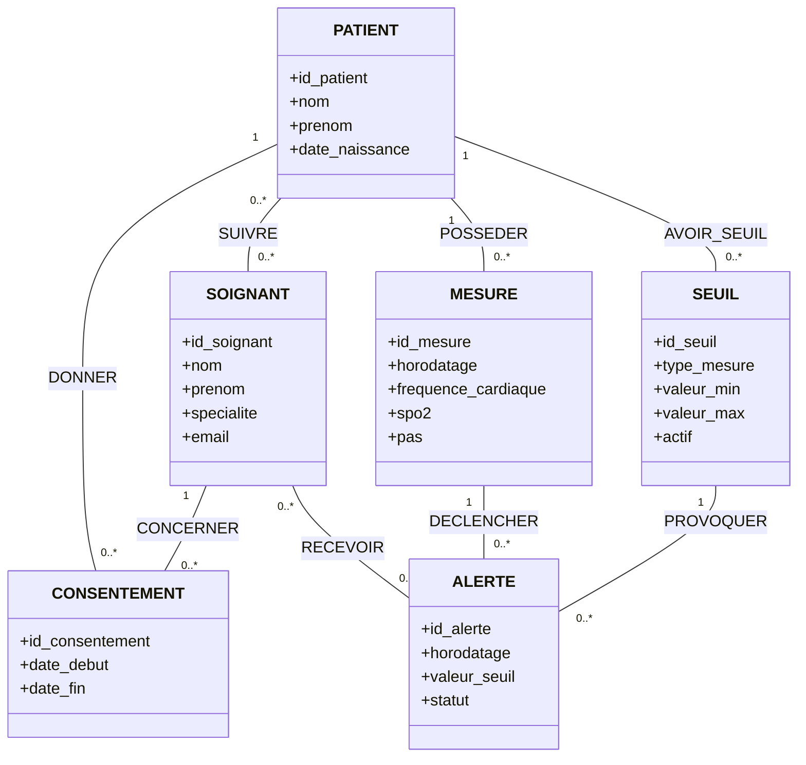
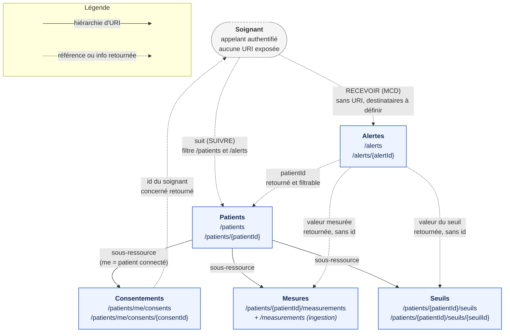

# Conception — Veillo, télésuivi de patients

## 1. Présentation de l’architecture

Veillo est le projet du Mastère 2 Web Services, sujet 6 : télésuivi de patients à domicile. Les montres sont simulées et toutes les données sont fictives.

Le simulateur transmettra des mesures à l’API REST NestJS/TypeScript. L’API les conservera dans PostgreSQL et prendra en charge les seuils, les alertes, les consentements et les consultations autorisées.

Une application mobile externe consommera l’API. **Aucun frontend n’est à développer par l’équipe.**

Ce document décrit la conception retenue et les questions ouvertes, sans attester de leur réalisation. Le [README](../README.md) présente l’état du projet, les commandes et les vérifications.

## 2. Responsabilités des composants

- **Simulateur IoT :** simuler des montres connectées, produire des mesures fictives et les transmettre par lots toutes les minutes. Il n’accédera pas directement à la base. Sa technologie et son organisation interne restent à définir.
- **API REST NestJS/TypeScript :** recevoir et valider les données, appliquer les règles métier et la sécurité, gérer la persistance et exposer les opérations HTTP.
- **PostgreSQL :** stocker les patients, soignants, mesures, seuils, alertes et consentements. Son mode d’intégration au backend reste à choisir.
- **Application mobile externe :** appeler l’API en tant que client, sans faire partie des composants développés par l’équipe.

## 3. Échanges prévus

Le simulateur et le client mobile communiqueront avec l’API en **HTTP/JSON**. Le simulateur enverra les lots ; le client mobile utilisera les opérations de consultation et de gestion selon ses droits.

L’API assurera le stockage et la lecture dans PostgreSQL. Cette liaison relève de la persistance, pas du contrat HTTP/JSON.

La documentation API est répartie entre deux documents :

- [api.md](api.md) : endpoints, méthodes HTTP, données échangées, traitements et règles métier.
- [api-review.md](api-review.md) : réponses HTTP de chaque endpoint, situations de succès ou d’erreur et points à valider.

Les requêtes Bruno du TP1 explorent httpbin et HAPI FHIR. Elles ne constituent pas le contrat de Veillo et n’imposent pas FHIR comme format métier.

## 4. Modélisation des données

Le MCD, réalisé avec Mocodo, comporte **6 entités et 8 associations**. Aucune association ne possède d’attribut.

[**Voir le MCD du projet Veillo**](images/mcd-veillo.png)

### Diagramme de classes Mermaid

Ce diagramme est une représentation UML du modèle conceptuel, et non un schéma physique PostgreSQL.



### Le modèle Mocodo

Ce code permet de reproduire le MCD dans Mocodo.

```text mocobo
%% Veillo - MCD (sujet 6 : telesuivi patient)

CONSENTEMENT: id_consentement, date_debut, date_fin
DONNER, 0N PATIENT, 11 CONSENTEMENT
PATIENT: id_patient, nom, prenom, date_naissance
AVOIR_SEUIL, 0N PATIENT, 11 SEUIL
SEUIL: id_seuil, type_mesure, valeur_min, valeur_max, actif

CONCERNER, 0N SOIGNANT, 11 CONSENTEMENT
SUIVRE, 0N PATIENT, 0N SOIGNANT
POSSEDER, 0N PATIENT, 11 MESURE
:
PROVOQUER, 0N SEUIL, 11 ALERTE

SOIGNANT: id_soignant, nom, prenom, specialite, email
:
MESURE: id_mesure, horodatage, frequence_cardiaque, spo2, pas
DECLENCHER, 0N MESURE, 11 ALERTE
ALERTE: id_alerte, horodatage, valeur_seuil, statut

:
RECEVOIR, 0N SOIGNANT, 0N ALERTE
:
```

### Choix de conception retenus

- **Suivi :** plusieurs soignants par patient et inversement. Aucun historique des suivis, car les fonctionnalités demandées n’en ont pas besoin ; seul le suivi actuel est représenté.
- **Mesures :** une mesure appartient à un patient et regroupe fréquence cardiaque, SpO₂, nombre de pas et horodatage. Elle peut dépasser plusieurs seuils.
- **Seuils :** un minimum et un maximum par patient et type de mesure pour repérer les valeurs anormales. Un seul seuil actif est autorisé pour un même patient et un même type de mesure ; un seuil désactivé est conservé.
- **Alertes :** chaque alerte est liée à une mesure et à un seuil. Pour garder le modèle simple, aucune date d’envoi ou de lecture n’est conservée. `RECEVOIR` autorise zéro à plusieurs destinataires ; le minimum attendu reste à confirmer.
- **Consentement :** il relie un patient et un soignant. `date_debut` marque le début de validité ; `date_fin` indique la fin ou le retrait. Le consentement retiré et la trace de son retrait sont conservés, sans supprimer l’historique des données. Cela ne définit pas un historique complet des renouvellements et retraits successifs.

Aucune justification supplémentaire n’a été documentée pour le regroupement des mesures et les seuils individuels.

## 5. Modèle de ressources REST



## 6. Règles métier

L’API devra appliquer les règles suivantes, que le MCD ne suffit pas à exprimer :

- **Mesures :** recevoir les lots du simulateur et associer chaque mesure au patient concerné. Une mesure regroupe fréquence cardiaque, SpO₂, nombre de pas et horodatage.
- **Seuils :** comparer les mesures aux seuils applicables du même patient. Un seul seuil actif est autorisé par patient et type de mesure. La création ou l’activation est refusée si un autre seuil actif du même type existe déjà ; la désactivation conserve le seuil.
- **Alertes :** créer une alerte `ACTIVE` lorsqu’une mesure dépasse un seuil applicable. L’alerte est liée à cette mesure et à ce seuil, qui doivent appartenir au même patient. Une mesure peut déclencher plusieurs alertes. Le soignant peut passer le statut à `TRAITEE` ; une alerte traitée reste dans l’historique et ne peut pas être réactivée.
- **Destinataires :** prévenir les soignants concernés par notification push, avec un message générique sans donnée de santé, selon [api.md](api.md#notifications-des-alertes). Les critères de sélection des destinataires restent à préciser.
- **Consentement :** relier un patient et un soignant et vérifier sa validité lors des consultations concernées. Son retrait empêche immédiatement les accès concernés.
- **Accès aux mesures :** un soignant doit posséder les droits nécessaires, suivre le patient et disposer d’un consentement valide de ce patient.

## 7. Sécurité

**Choix retenu : OAuth 2.0 avec des jetons d’accès JWT.** Les scopes seront distincts pour les montres, les patients et les soignants.

Trois notions se complètent :

- **Authentification :** identifier l’appelant.
- **Autorisation :** vérifier ses permissions et ses droits sur les ressources demandées. Un scope précise les actions autorisées, pas les patients concernés.
- **Consentement :** autorisation donnée par un patient à un soignant pour accéder à ses données.

Le backend devra vérifier la signature et la validité des JWT, leurs informations d’autorisation et les droits sur les ressources. Il contrôlera le consentement à chaque accès concerné.

Les réponses seront limitées aux données nécessaires. Aucune donnée de santé sensible ne devra figurer dans les logs, y compris dans les messages d’erreur.

Pour le client mobile, **Authorization Code avec PKCE est une option recommandée à étudier**, pas un flux déjà validé. Le fournisseur OAuth, les flux exacts, les noms des scopes et la correspondance entre identités OAuth et entités métier restent à préciser.

## 8. Décisions restant à clarifier

Les points suivants restent ouverts ; ils ne constituent pas des décisions validées.

### Consentements

- Préciser les conditions de validité des dates et la possibilité d’un consentement sans `date_fin`.
- Déterminer si un patient peut renouveler un consentement après son retrait ou en avoir plusieurs pour un même soignant.

### Périmètre du contrôle du consentement

La comparaison des contrats fait apparaître les situations suivantes :

- **Contrôle explicite :** `GET /patients/{patientId}/measurements` et `GET /alerts/{alertId}` vérifient le consentement valide, en plus du suivi et des autorisations.
- **Contrôle non précisé :** `GET /patients`, `GET /patients/{patientId}`, `GET /alerts` et `GET /patients/{patientId}/seuils` ne mentionnent pas de vérification du consentement. Il reste à décider si les informations retournées nécessitent ce contrôle et comment le retrait affecte ces accès.
- **Consentements du patient connecté :** `GET /patients/me/consents` repose sur son authentification pour retrouver ses propres consentements, sans contrôle d’un consentement accordé à un soignant.
- **Actions du soignant :** le consentement n’est pas explicité pour `PATCH /alerts/{alertId}` ni pour la création et la modification des seuils. Son application à ces actions reste à décider.

Ces différences ne signifient pas que les accès sans consentement sont autorisés. Leur périmètre doit être validé selon les données et l’action concernées, sans imposer automatiquement une règle uniforme.

### Seuils

- Confirmer si un dépassement correspond à une valeur hors de l’intervalle `valeur_min`–`valeur_max`.
- Préciser les modalités d’application de `actif` lors de l’évaluation des mesures. L’unicité du seuil actif est retenue ; la possibilité de conserver plusieurs seuils inactifs pour un même patient et un même type reste à préciser.

### Alertes

- Choisir les destinataires : tous les soignants qui suivent le patient, ou seulement ceux ayant un consentement valide ?
- Confirmer si une alerte peut n’avoir aucun destinataire : `RECEVOIR` l’autorise, alors que le texte initial prévoyait « un ou plusieurs » soignants.
- Préciser le contenu de `valeur_seuil`. Les statuts `ACTIVE` et `TRAITEE`, ainsi que la transition sans réactivation, sont définis dans [api.md](api.md).
- **Acquittement individuel : incohérence à résoudre.** L’API décrit actuellement une mise à jour du statut commun de l’alerte. Un acquittement propre à chaque soignant avait aussi été envisagé, mais `statut` appartient à `ALERTE` et `RECEVOIR` n’a aucun attribut. Ce besoin individuel reste à trancher ; aucune solution ni modification du MCD n’est décidée ici.

### Contrats techniques

Les contrats documentés sont regroupés dans [api.md](api.md) (endpoints, lots et notifications) et [api-review.md](api-review.md) (réponses HTTP et cas à valider). Les points suivants restent à préciser :

- L’identification du patient et de l’émetteur d’un lot, ainsi que les modalités de sécurité laissées ouvertes en section 7. Le MCD ne contient pas d’entité dédiée aux comptes.
- L’ordre et les garanties entre stockage des mesures, évaluation des seuils et création des alertes.
- Le mode d’intégration de PostgreSQL au backend ; le MCD reste conceptuel.
