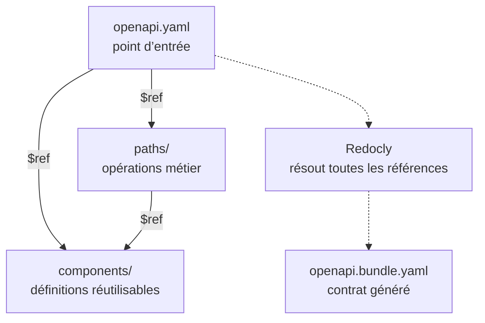

# TP3 — Outillage du contrat OpenAPI

Ce guide décrit les sources OpenAPI 3.1 et leur validation, sans backend. Pour les essais HTTP et le dépannage Bruno, voir le [guide Prism](mock-prism.md). Il faut Node.js 22 et `npx` ; le premier lancement peut télécharger les outils.

<a id="1-organisation-du-contrat-openapi"></a>

## Architecture des contrats OpenAPI

Le contrat sépare les opérations métier des définitions partagées. Chaque développeur intervient dans le domaine concerné sans recopier les schémas ou les erreurs communes.



Traits pleins : références entre fichiers sources. Pointillés : génération du bundle à partir de cet ensemble.

### 1. Le fichier parent : `openapi.yaml`

[openapi.yaml](../openapi/openapi.yaml) est le **point d’entrée** de l’API. Il contient les informations générales, les serveurs, les URI, la sécurité commune et les références vers les opérations et composants.

Il indique où trouver les définitions ; il ne contient pas tout leur détail. Redocly et Prism partent de ce fichier pour charger le contrat complet.

### 2. Les opérations métier : `paths/`

[paths/](../openapi/paths/) décrit les méthodes HTTP, paramètres, corps de requête, réponses et règles contractuelles de chaque domaine.

```text
openapi/paths/
├── patients.yaml        # Liste et détail des patients suivis
├── measurements.yaml    # Ingestion des lots et lecture des mesures
├── alerts.yaml          # Liste, détail et acquittement des alertes
├── consents.yaml        # Consultation et retrait des consentements
└── seuils.yaml          # Liste, détail, création et modification des seuils
```

Le parent associe chaque URI à un bloc de ces fichiers. L’opération réutilise ensuite les composants avec des `$ref`. Les noms `ingestion`, `patientMeasurements`, `collection` et `item` désignent des blocs YAML, pas des routes HTTP.

### 3. Les définitions réutilisables : `components/`

[components/](../openapi/components/) regroupe les éléments utilisés par plusieurs opérations. Modifier une définition ici peut affecter tous les fichiers qui la référencent.

```text
openapi/components/
├── schemas.yaml       # Structures JSON, types et contraintes
├── responses.yaml     # Erreurs communes 401, 403 et 404
├── parameters.yaml    # Identifiants, filtres et pagination
├── examples.yaml      # Exemples fictifs d’erreurs communes
├── security.yaml      # Mécanisme d’authentification Bearer/JWT
└── cache.yaml         # En-têtes, paramètres, réponses et exemples du cache
```

Le cache des seuils est centralisé dans `cache.yaml` : `ETag`, `If-Match`, `If-None-Match`, `304`, `412` et `428`. Voir le [guide du cache](contrats/cache.md).

`security.yaml` décrit le mécanisme d’authentification ; le bloc `security` de chaque opération porte ses permissions provisoires. Le fournisseur, les flux OAuth et les noms définitifs des scopes restent à valider.

### 4. Le contrat généré : `openapi.bundle.yaml`

[openapi.bundle.yaml](../openapi/openapi.bundle.yaml) rassemble le parent et les fichiers référencés dans un seul contrat. Redocly le génère ; **ne pas le modifier manuellement**, car la prochaine génération écraserait ces changements.

Avec la configuration actuelle, Spectral utilise le bundle pour éviter le rejet des références de chemins du parent. Prism accepte directement le parent et ses références.

`Modifier les sources → régénérer le bundle → valider → tester avec Prism et Bruno`.

Les [commandes de génération et de validation](#1-génération-du-bundle-et-validation-spectral) figurent ci-dessous.

### Exemple concret : `POST /measurements`

**1. Le parent sélectionne le bloc de la route**, dans [openapi.yaml](../openapi/openapi.yaml) :

```yaml
paths:
  /measurements:
    $ref: "./paths/measurements.yaml#/ingestion"
```

**2. Le POST définit son corps**, dans [paths/measurements.yaml](../openapi/paths/measurements.yaml). Extrait du bloc `ingestion` :

```yaml
post:
  requestBody:
    required: true
    content:
      application/json:
        schema:
          $ref: "../components/schemas.yaml#/MeasurementBatch"
```

**3. Le schéma décrit les données**, dans [components/schemas.yaml](../openapi/components/schemas.yaml). `MeasurementBatch` exige `patientId`, `batchId` et un tableau `measurements` non vide ; chaque élément réutilise `Measurement` :

```yaml
measurements:
  type: array
  minItems: 1
  items:
    $ref: "#/Measurement"
```

Le POST référence aussi les réponses partagées de [responses.yaml](../openapi/components/responses.yaml), par exemple `Unauthorized` pour le `401`.

`/measurements → ingestion.post → MeasurementBatch → Measurement`.

**Lire une `$ref` :** avant `#`, le chemin part du fichier qui contient la référence : `./` reste dans son dossier, `../` remonte d’un dossier. Sans chemin, la référence reste dans le même fichier. Après `#`, le fragment sélectionne une définition : `#/Measurement` vise une clé ; `#/headers/ETag` descend dans `headers`, puis `ETag`.

Ces extraits montrent les liens existants, pas l’intégralité de l’opération. Le [guide des mesures](contrats/mesures.md) présente le JSON retenu ; types d’identifiants, unités, bornes et modalités d’autorisation du simulateur restent ouverts.

### À part : la configuration du lint

[.spectral.yaml](../openapi/.spectral.yaml) contient les règles de vérification, dont `operation-operationId`. Ce fichier ne décrit aucun échange HTTP : **il ne fait pas partie du contrat ni du bundle**. Le modifier uniquement pour faire évoluer les contrôles du projet.

### Quel fichier modifier ?

- **Endpoint :** son fichier dans `paths/`, par exemple `ingestion.post` dans `measurements.yaml`. Adapter aussi le parent si l’URI change.
- **JSON :** son schéma dans [schemas.yaml](../openapi/components/schemas.yaml), par exemple `Measurement` ou `ThresholdCreate`.
- **Erreur commune :** [responses.yaml](../openapi/components/responses.yaml), puis les références des opérations concernées.
- **Paramètre commun :** [parameters.yaml](../openapi/components/parameters.yaml).
- **Exemple :** [examples.yaml](../openapi/components/examples.yaml) pour `BadRequest` ; `paths/` pour un succès défini dans l’opération ; [cache.yaml](../openapi/components/cache.yaml) pour le cache.
- **Cache :** `cache.yaml` et ses références dans [paths/seuils.yaml](../openapi/paths/seuils.yaml).
- **Sécurité :** [security.yaml](../openapi/components/security.yaml) pour le mécanisme, `security` dans les opérations pour leurs permissions.

Toute évolution doit rester cohérente avec [design.md](design.md), [api.md](api.md) et [api-review.md](api-review.md).

## 1. Génération du bundle et validation Spectral

Redocly regroupe les sources ; Spectral vérifie le bundle et les règles du projet. Après une modification, lancer depuis la racine :

```bash
npx @redocly/cli bundle openapi/openapi.yaml -o openapi/openapi.bundle.yaml
npx @stoplight/spectral-cli lint openapi/openapi.bundle.yaml --ruleset openapi/.spectral.yaml
```

Attendre une génération réussie et **0 erreur Spectral** ; lire aussi les avertissements.

Dans `.spectral.yaml` :

- `operation-operationId` exige un identifiant pour chaque opération.
- `security-roles-known` vérifie les noms provisoires `montre`, `patient` et `soignant`.
- Les règles HTTP contrôlent `WWW-Authenticate` sur les `401`, `Location` sur les `201` et `application/problem+json` pour les erreurs documentées.
- `oas3-operation-security-defined` est désactivée : cette règle attend des scopes OAuth, alors que le contrat utilise encore un schéma Bearer avec des rôles OpenAPI 3.1.

Un essai OAuth2 avec `authorizationCode`, `clientCredentials` et des URL fictives a passé Redocly, Spectral (règle native réactivée, scope inconnu détecté) et Prism. **Ce test ne valide pas ces flux pour Veillo** : fournisseur, flux et noms définitifs des scopes restent à décider.

## 2. Documentation Redocly

Redocly valide aussi le parent et produit une page HTML à consulter dans un navigateur. Depuis la racine :

```bash
npx @redocly/cli lint openapi/openapi.yaml
npx @redocly/cli build-docs openapi/openapi.yaml -o docs/index.html
```

Vérifier l’absence d’erreur, lire les avertissements puis ouvrir [index.html](index.html). Le fichier du dépôt est encore vide : la page reste à générer.

## 3. Mock Prism

Prism simule l’API sans démarrer NestJS. Après validation du contrat, lancer depuis la racine :

```bash
npx @stoplight/prism-cli mock openapi/openapi.yaml
```

Prism doit afficher les **13 opérations** et écouter sur `http://127.0.0.1:4010`. Garder le terminal ouvert ; `Ctrl+C` arrête le mock.

Prism vérifie les schémas et renvoie des exemples statiques : ses réponses ne suivent pas forcément les valeurs envoyées. Sans `Authorization: Bearer …`, il répond `401`.

Il ne vérifie pas la signature des JWT, les scopes, les droits, les doublons, la persistance ou les règles comme `valeurMin <= valeurMax` et l’unicité du seuil actif.

## 4. Client Bruno

Bruno envoie les requêtes et contrôle les statuts, en-têtes et JSON. Les fichiers sont dans [bruno/tp3-mock/](../bruno/tp3-mock/). L’environnement [mock.bru](../bruno/environments/mock.bru) fournit `baseUrl = http://127.0.0.1:4010`, `patientId`, `seuilId` et un `token` factice.

Avec Prism démarré, exécuter depuis le dossier `bruno/` :

```bash
npx @usebruno/cli run tp3-mock --env mock
```

Cas couverts par les fichiers Bruno :

- **01 — `listPatients` :** `GET /patients` attend `200`. Les assertions `items` et `pagination` reposent sur un format encore ouvert : un échec peut venir du test.
- **02 — `createPatientThreshold` :** création avec `201`, `Location` et un `Threshold` actif (`seuilId`, `patientId`, `typeMesure`, bornes, `actif`). Le [guide des seuils](contrats/seuils.md) détaille ce JSON et l’enum commune aux alertes.
- **03 — `ingestMeasurements` :** `POST /measurements` attend `400`, car `patientId` manque. La note évoquant un UUID obligatoire et une SpO₂ limitée à 100 est obsolète : ces contraintes ne sont pas définies.
- **04 à 07 — `updatePatientThreshold` :** PATCH valide → `200` ; corps vide, valeur nulle ou propriété inconnue → `400` en `application/problem+json`.

### Que renvoie Prism pour un corps invalide ?

Lire `sl-violations` : il décrit les contraintes violées. La requête 03 utilisait l’exemple `BadRequest`, conforme à `Problem`, en `application/problem+json`. Son `detail` fictif ne remplace pas l’erreur réelle attendue du backend ; voir les [limites du mock](mock-prism.md#résultats-et-preuves).

## Résultats déjà consignés

- **Spectral :** découpage validé avec 0 erreur et 0 avertissement, avant les évolutions Mesures et Alertes.
- **Redocly :** 0 erreur et 2 avertissements : licence absente (`info-license`) et serveur local (`no-server-example.com`).
- **Prism :** 118 appels identiques avant/après découpage : 12 succès, 43 erreurs forcées et 4 requêtes invalides par version. Ce contrôle précède les schémas actuels des relevés et alertes.
- **Bruno :** vérification ciblée des seuils réussie, 5 requêtes et 11 tests. Les requêtes 01 et 03 n’ont pas été rejouées à cette occasion ; la collection complète n’a pas été réexécutée après le découpage.

Ces résultats concernent des versions successives du contrat, pas une nouvelle exécution ni une validation du backend métier.

Le fichier attendu `docs/mock.png` est absent. Les [captures disponibles](mock-prism.md#résultats-et-preuves) montrent des versions antérieures des échanges.
