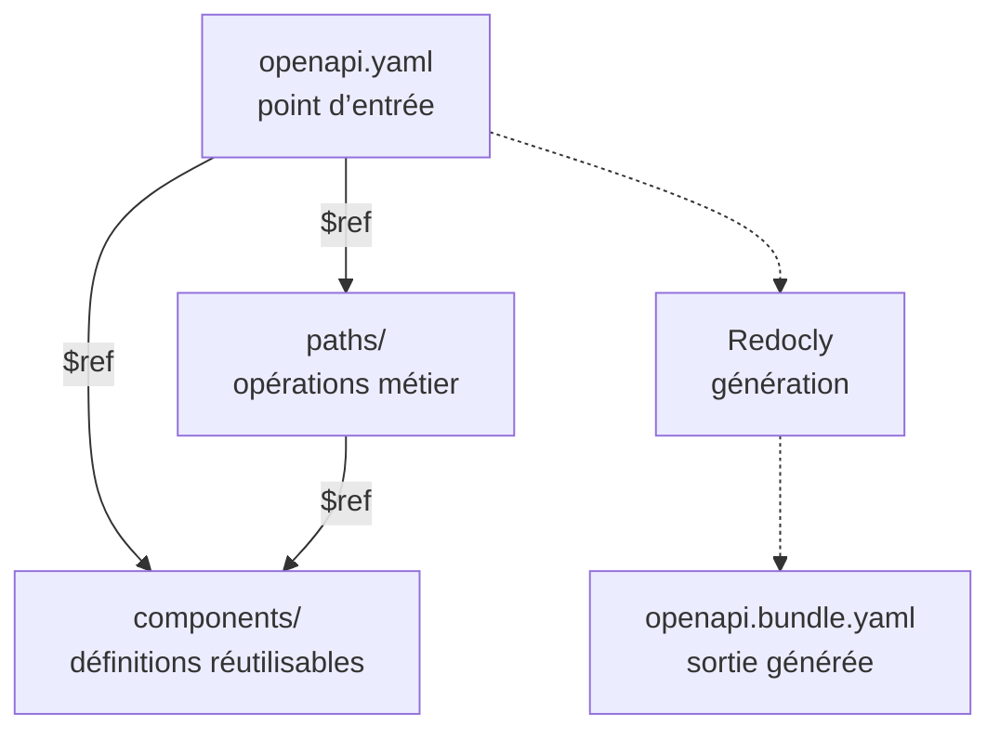

# TP3 — Outillage du contrat OpenAPI

Ce guide explique où modifier le contrat de Veillo, puis comment le valider et l’utiliser sans backend. Pour les essais HTTP et le dépannage Bruno, voir le [guide Prism](mock-prism.md).

**Prérequis :** Node.js 22, npm avec `npx` et un terminal ouvert à la racine du dépôt. Le premier téléchargement des outils nécessite un accès réseau.

<a id="1-organisation-du-contrat-openapi"></a>

## Architecture des contrats OpenAPI

**OpenAPI 3.1 décrit les échanges HTTP attendus** : routes, paramètres, JSON, réponses et exigences d’accès. Il sert de contrat commun au backend, au simulateur et aux clients.

Le découpage sépare les opérations métier des définitions partagées. Chacun peut travailler dans son domaine sans recopier les schémas ou les erreurs communes.



Traits pleins : références entre sources. Pointillés : génération du contrat regroupé.

### 1. Le fichier parent : `openapi.yaml`

[openapi.yaml](../openapi/openapi.yaml) est le point d’entrée. Il contient les informations générales, les serveurs, les URI, la sécurité commune et les références vers les fichiers enfants.

Commencer par ce fichier pour retrouver une route. Redocly et Prism l’utilisent pour charger tout le contrat.

### 2. Les opérations métier : `paths/`

Chaque fichier de [paths/](../openapi/paths/) décrit les méthodes HTTP, paramètres, corps de requête et réponses de son domaine.

```text
openapi/paths/
├── patients.yaml       # Liste et détail des patients suivis
├── measurements.yaml   # Ingestion des lots et consultation
├── alerts.yaml         # Liste, détail et acquittement
├── consents.yaml       # Consultation et retrait
└── seuils.yaml         # Liste, détail, création et modification
```

Modifier ici le comportement HTTP d’une opération. Le parent relie l’URI à un bloc comme `ingestion`, `patientMeasurements`, `collection` ou `item` : ces noms sont des clés YAML, pas de nouvelles routes.

### 3. Les définitions réutilisables : `components/`

[components/](../openapi/components/) contient les définitions partagées par les opérations.

```text
openapi/components/
├── schemas.yaml       # Structures JSON, types et contraintes
├── responses.yaml     # Réponses d’erreur partagées
├── parameters.yaml    # Identifiants, filtres et pagination
├── examples.yaml      # Exemples fictifs d’erreurs communes
├── security.yaml      # Authentification Bearer/JWT
└── cache.yaml         # En-têtes et réponses conditionnelles
```

Modifier une définition commune affecte les opérations qui la référencent. Par exemple, les règles de `ThresholdPatch` restent dans `schemas.yaml` ; `ETag`, `If-Match`, `If-None-Match` et les réponses `304`, `412`, `428` sont centralisés dans `cache.yaml`.

Pour les échanges HTTP et les règles associées, lire les guides [Seuils](contrats/seuils.md) et [Cache](contrats/cache.md).

`security.yaml` décrit le mécanisme d’authentification. Le bloc `security` de chaque opération porte ses permissions provisoires. Fournisseur, flux OAuth et noms définitifs des scopes restent à valider.

### 4. Le contrat généré : `openapi.bundle.yaml`

[openapi.bundle.yaml](../openapi/openapi.bundle.yaml) regroupe le parent et les fichiers référencés. Redocly le génère : **ne jamais le modifier à la main**, car une nouvelle génération écraserait ces changements.

Avec la configuration actuelle, Spectral utilise le bundle pour éviter le rejet des références de chemins du parent. Prism sait charger directement le parent et ses références.

```text
parent + paths + components → Redocly → bundle → Spectral
parent + paths + components → Prism → requêtes Bruno
```

### Exemple : `POST /measurements` et les `$ref`

Une `$ref` renvoie vers une définition existante. Elle évite de recopier les mêmes structures dans chaque opération.

**Dans le parent**, la route charge le bloc `ingestion` de [measurements.yaml](../openapi/paths/measurements.yaml) :

```yaml
paths:
  /measurements:
    $ref: "./paths/measurements.yaml#/ingestion"
```

**Dans l’opération**, le corps utilise `MeasurementBatch` de [schemas.yaml](../openapi/components/schemas.yaml) :

```yaml
post:
  requestBody:
    required: true
    content:
      application/json:
        schema:
          $ref: "../components/schemas.yaml#/MeasurementBatch"
```

**Dans le schéma**, le tableau non vide réutilise `Measurement` du même fichier :

```yaml
measurements:
  type: array
  minItems: 1
  items:
    $ref: "#/Measurement"
```

`/measurements → ingestion.post → MeasurementBatch → Measurement`.

Le chemin avant `#` part du **fichier qui contient la référence** : `./` reste dans son dossier et `../` remonte d’un niveau. Sans chemin, la référence reste dans le même fichier.

Le fragment après `#` sélectionne une définition : `#/Measurement` vise cette clé ; `#/headers/ETag` descend dans `headers` puis `ETag`.

Ces extraits sont partiels. Le POST réutilise aussi `responses.yaml#/Unauthorized` pour son `401`. Le [guide des mesures](contrats/mesures.md) donne le JSON retenu : `patientId`, `batchId` et au moins un relevé sont obligatoires. Formats d’identifiants, unités, bornes et autorisations du simulateur restent ouverts.

### À part : `.spectral.yaml`

[.spectral.yaml](../openapi/.spectral.yaml) configure le lint, c’est-à-dire les contrôles automatiques du contrat. Il ne décrit aucun échange HTTP et ne fait pas partie du bundle.

Modifier ce fichier seulement pour faire évoluer les règles de vérification.

### Quel fichier modifier ?

- **Une opération :** son fichier dans `paths/`, par exemple `ingestion.post` dans `measurements.yaml`. Une URI nouvelle ou modifiée nécessite aussi une référence dans le parent, après validation de l’équipe.
- **Une structure JSON :** son schéma dans [schemas.yaml](../openapi/components/schemas.yaml), par exemple `Measurement` ou `ThresholdCreate`.
- **Une réponse d’erreur commune :** [responses.yaml](../openapi/components/responses.yaml), puis les références nécessaires.
- **Un paramètre partagé :** [parameters.yaml](../openapi/components/parameters.yaml).
- **Un exemple :** [examples.yaml](../openapi/components/examples.yaml) pour une erreur commune ; `paths/` pour un exemple défini dans l’opération ; [cache.yaml](../openapi/components/cache.yaml) pour le cache.
- **Le cache :** `cache.yaml` et ses références dans [seuils.yaml](../openapi/paths/seuils.yaml).
- **La sécurité :** [security.yaml](../openapi/components/security.yaml) pour le mécanisme, `security` dans les opérations pour leurs permissions.

`Modifier la source → régénérer le bundle → valider → tester`.

Conserver la cohérence avec [design.md](design.md), [api.md](api.md) et [api-review.md](api-review.md). Ne pas fermer une décision métier ouverte par une simple modification de schéma.

## 1. Génération du bundle et validation Spectral

**Spectral vérifie le contrat et les règles du projet.** L’utiliser après chaque modification des sources, une fois le bundle régénéré par Redocly.

Depuis la racine :

```bash
npx @redocly/cli bundle openapi/openapi.yaml -o openapi/openapi.bundle.yaml
npx @stoplight/spectral-cli lint openapi/openapi.bundle.yaml --ruleset openapi/.spectral.yaml
```

**Résultat attendu :** génération réussie et 0 erreur Spectral. Lire aussi les avertissements. Cela ne teste pas le comportement de NestJS.

Les règles actuelles contrôlent notamment :

- `operation-operationId` : chaque opération possède un identifiant.
- `security-roles-known` : les noms provisoires sont `montre`, `patient` et `soignant`.
- Les réponses HTTP : `WWW-Authenticate` exigé sur les `401`, `Location` déclaré sur les `201` et erreurs en `application/problem+json`.

`oas3-operation-security-defined` est désactivée : la règle native attend des scopes OAuth, alors que le contrat utilise encore Bearer avec des rôles OpenAPI 3.1.

Un essai antérieur avec `authorizationCode`, `clientCredentials` et des URL fictives avait passé Redocly, Spectral et Prism. La règle native réactivée détectait un scope inconnu. **Cet essai ne valide ni ces flux ni un fournisseur OAuth pour Veillo.**

## 2. Documentation Redocly

**Redocly vérifie et regroupe les sources, puis peut générer une documentation HTML.** Utiliser le lint pour contrôler le parent et `build-docs` pour produire une page à consulter ou partager.

Depuis la racine :

```bash
npx @redocly/cli lint openapi/openapi.yaml
npx @redocly/cli build-docs openapi/openapi.yaml -o docs/index.html
```

**Résultat attendu :** aucune erreur, avertissements examinés et page lisible dans [index.html](index.html). Le fichier versionné est actuellement vide : la page reste à générer.

## 3. Mock Prism

**Prism simule les échanges HTTP depuis OpenAPI, sans lancer NestJS.** L’utiliser après validation du contrat pour préparer les clients et tester leurs requêtes.

Depuis la racine :

```bash
npx @stoplight/prism-cli mock openapi/openapi.yaml
```

**Résultat attendu :** 13 opérations annoncées et écoute sur `http://127.0.0.1:4010`. Garder le terminal ouvert ; `Ctrl+C` arrête le mock.

Prism vérifie les schémas et renvoie des exemples statiques : le corps reçu ne reflète pas forcément les données envoyées. Sans `Authorization: Bearer …`, il répond `401`.

Il ne vérifie ni signature JWT, ni scopes, ni droits, ni consentement, ni persistance. Il ne prouve pas non plus les doublons, la comparaison des bornes ou l’unicité du seuil actif.

## 4. Client Bruno

**Bruno envoie des requêtes HTTP et vérifie leurs réponses avec des assertions.** L’utiliser une fois Prism démarré.

La collection [tp3-mock/](../bruno/tp3-mock/) contient sept requêtes. L’environnement [mock.bru](../bruno/environments/mock.bru) fournit `baseUrl = http://127.0.0.1:4010`, `patientId`, `seuilId` et un jeton factice.

Dans un second terminal, depuis la racine :

```bash
cd bruno
npx @usebruno/cli run tp3-mock --env mock
```

**Résultat attendu :** statuts, en-têtes et JSON conformes aux assertions. Un échec peut aussi révéler un test obsolète.

### Ce que couvrent les requêtes actuelles

- **01 — Patients :** attend `200` et les propriétés `items` et `pagination`. Cette enveloppe reste ouverte dans le contrat ; ces assertions sont une hypothèse du test.
- **02 — Création d’un seuil :** attend `201`, `Location` et les six champs de `Threshold`, avec `actif: true`.
- **03 — Lot invalide :** attend `400` car `patientId` manque. La note du fichier sur un UUID obligatoire et une SpO₂ limitée à 100 est obsolète : ces contraintes ne sont pas définies.
- **04 à 07 — PATCH d’un seuil :** attendent `200` pour le corps valide, puis `400` pour un corps vide, une valeur nulle et une propriété inconnue.

**Limite actuelle :** les quatre PATCH n’envoient pas `If-Match`. Ils explorent les schémas du mock et ne valident pas le parcours conditionnel prévu, où cet en-tête est exigé et son absence donne `428`.

Pour comprendre un rejet Prism, lire `sl-violations`. La requête 03 utilisait l’exemple fictif `BadRequest` en `application/problem+json` ; son `detail` ne remplace pas le diagnostic réel attendu du backend. Voir les [limites du mock](mock-prism.md#résultats-et-preuves).

## Résultats déjà consignés

Ces résultats sont **historiques** et portent sur des versions successives du contrat :

- **Spectral :** 0 erreur et 0 avertissement après découpage, avant les évolutions Mesures et Alertes.
- **Redocly :** 0 erreur et 2 avertissements : licence absente (`info-license`) et serveur local (`no-server-example.com`).
- **Prism :** 118 appels identiques avant/après découpage : 12 succès, 43 erreurs forcées et 4 requêtes invalides par version. Ce contrôle précède les schémas actuels des relevés et alertes.
- **Bruno :** vérification ciblée des seuils réussie, 5 requêtes et 11 tests. Les requêtes 01 et 03 n’avaient pas été rejouées ; la collection complète n’avait pas été réexécutée après le découpage.

Aucun essai HTTP ni nouveau lint du contrat n’a été exécuté pour cette révision documentaire. Les aides des CLI Prism et Bruno ont été consultées pour vérifier les commandes.

Le fichier attendu `docs/mock.png` est absent. Les [captures disponibles](mock-prism.md#résultats-et-preuves) montrent des échanges antérieurs, pas une validation du backend actuel.

Pour les tests générés depuis le contrat, poursuivre avec [Schemathesis](tests/schemathesis.md).
