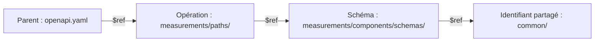
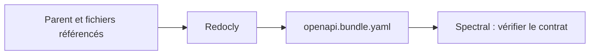

# Architecture des contrats API — Veillo

Les contrats sont regroupés **par ressource métier**, puis par responsabilité technique. Un développeur trouve ainsi les opérations, JSON, réponses et règles d’un domaine au même endroit.

Ce découpage organise les fichiers. Il ne change ni les routes, ni les échanges, ni la conception métier.

## Se repérer

```text
openapi/
├── measurements/           # Mesures : ingestion et consultation
├── patients/               # Liste et détail des patients
├── thresholds/             # Seuils : consultation, création et modification
├── alerts/                 # Alertes : consultation et traitement
├── consents/               # Consentements : consultation et retrait
├── caregivers/             # Guide Soignant ; aucun endpoint dédié en V1
├── cache/                  # ETag et requêtes conditionnelles des seuils
├── security/               # Authentification commune
├── common/                 # Définitions utilisées par plusieurs ressources
├── architecture-api.md     # Ce guide
├── .spectral.yaml          # Configuration du lint, hors contrat HTTP
├── openapi.yaml            # Point d’entrée des sources
└── openapi.bundle.yaml     # Contrat regroupé, généré
```

Guides métier : [Mesures](measurements/guide.md), [Patients](patients/guide.md), [Seuils](thresholds/guide.md), [Alertes](alerts/guide.md), [Consentements](consents/guide.md) et [Soignant](caregivers/guide.md). Le [guide Cache](cache/guide.md) décrit les échanges conditionnels.

## Dans une ressource

Exemple réel pour les alertes :

```text
alerts/
├── paths/
│   └── alerts.yaml
├── components/
│   ├── parameters/parameters.yaml
│   ├── schemas/schemas.yaml
│   ├── responses/responses.yaml
│   └── examples/examples.yaml
└── guide.md
```

- **`paths/`** : méthodes HTTP, paramètres et corps de requête des opérations. Les réponses y sont référencées.
- **`parameters/`** : paramètres de chemin, de requête ou d’en-tête propres au domaine.
- **`schemas/`** : structures JSON et contraintes de validation.
- **`responses/`** : réponses avec leur description, corps et en-têtes. Le code HTTP est associé à la réponse dans `paths/`.
- **`examples/`** : exemples référencés par les requêtes et les réponses.
- **`guide.md`** : rôle métier, échanges, règles et décisions encore ouvertes.

Les sous-dossiers restent séparés, même avec un seul fichier. Un fichier peut contenir plusieurs définitions nommées.

**Seuls les éléments existants sont créés.** Par exemple, les paramètres des mesures sont tous partagés : ils restent dans `common/`. `caregivers/` contient uniquement son guide V1, sans route ni schéma fictif.

## Définitions transversales

**[common/](common/components/)** évite de recopier les définitions réellement partagées :

- `parameters/` : `patientId`, période et pagination.
- `schemas/` : `Identifier`, `MeasurementType` et `Problem`.
- `responses/` : authentification, permissions et patient introuvable ou inaccessible.
- `examples/` : erreurs communes fictives.

Les composants propres à une ressource restent dans cette ressource. Par exemple, `AlertStatus` appartient aux alertes, tandis que `MeasurementType` est commun aux alertes et aux seuils.

**[security/components/security.yaml](security/components/security.yaml)** définit Bearer/JWT. Les permissions provisoires restent dans le bloc `security` des opérations. Fournisseur OAuth, flux et scopes définitifs restent à valider.

**[cache/](cache/guide.md)** centralise les requêtes conditionnelles des seuils :

```text
cache/components/
├── parameters/parameters.yaml   # If-Match et If-None-Match
├── headers/headers.yaml         # ETag
├── responses/responses.yaml     # 304, 412 et 428
└── examples/examples.yaml       # Erreurs de précondition
```

## Parent, références et bundle

### Le parent : retrouver une opération

**[openapi.yaml](openapi.yaml) est le point d’entrée du contrat.** Commencer par ce fichier pour retrouver une URI.

Il contient les informations générales, les serveurs et la sécurité commune. Les opérations et définitions sont reliées à leurs fichiers sources par des `$ref`.

### Les références : relier les sources

Une **`$ref` pointe vers une définition existante**. Elle permet de réutiliser un schéma ou une réponse sans les recopier.

Pour les mesures, voici une chaîne de références réelle :



Le chemin se lit **depuis le fichier qui contient la référence** :

- `./` reste dans son dossier ; `../` remonte d’un niveau.
- Le fragment après `#` sélectionne une clé YAML, par exemple `#/MeasurementBatch`.
- Sans chemin avant `#`, la définition se trouve dans le même fichier.

Le parent possède aussi une section OpenAPI `components`. C’est un catalogue de références, pas un dossier global.

### Le bundle : regrouper le contrat

**[openapi.bundle.yaml](openapi.bundle.yaml) rassemble les sources dans un seul document.** Il sert aux outils qui attendent un contrat regroupé.

**Redocly** part du parent, suit les `$ref` et génère ce fichier. **Ne pas modifier le bundle à la main** : la prochaine génération écraserait ces changements.



Avec la configuration actuelle, **Spectral utilise le bundle** pour éviter le rejet des références de chemins du parent.

**Prism charge directement le parent et ses références.** Il simule les réponses HTTP sans lancer NestJS :

```text
openapi.yaml + fichiers référencés → Prism → requêtes Bruno
```

## Exemple : POST /measurements

**1. Retrouver l’opération dans le parent.** Dans [openapi.yaml](openapi.yaml), l’URI pointe vers la clé `ingestion` :

```yaml
paths:
  /measurements:
    $ref: ./measurements/paths/measurements.yaml#/ingestion
```

**2. Lire le schéma du corps reçu.** Dans [measurements.yaml](measurements/paths/measurements.yaml), le corps référence `MeasurementBatch` :

```yaml
schema:
  $ref: ../components/schemas/schemas.yaml#/MeasurementBatch
```

**3. Suivre les définitions réutilisées.** Dans [schemas.yaml](measurements/components/schemas/schemas.yaml) :

- `#/Measurement` décrit chaque relevé dans le même fichier.
- `../../../common/components/schemas/schemas.yaml#/Identifier` décrit les identifiants partagés.

**4. Consulter l’exemple et la réponse.** [examples.yaml](measurements/components/examples/examples.yaml) contient le lot fictif envoyé à l’API.

Le `201` pointe vers [responses.yaml](measurements/components/responses/responses.yaml). Ce fichier décrit la confirmation du lot et l’en-tête `Location`.

Ces fichiers décrivent les échanges attendus. Ils ne prouvent pas que le backend traite déjà les lots.

## Quel fichier modifier ?

- **Route ou opération HTTP :** `paths/` de la ressource. Modifier aussi le parent si une URI validée évolue.
- **Structure JSON :** `components/schemas/` de la ressource.
- **Réponse HTTP :** `components/responses/` ; **exemple :** `components/examples/`.
- **Définition partagée :** `common/`, uniquement si plusieurs ressources l’utilisent.
- **Cache HTTP :** `cache/` et, si nécessaire, ses références dans les seuils.
- **Sécurité :** mécanisme dans `security/`, permissions dans les opérations.
- **Règle métier documentée :** `guide.md` de la ressource. Conserver la cohérence avec la [conception](../docs/design.md) et la [documentation API](../docs/api.md).

## Vérifier et utiliser le contrat

**Prérequis :** Node.js 22, npm et un terminal à la racine du dépôt. Le [guide d’outillage TP3](../docs/outillage-tp3.md) détaille les outils et leurs limites.

### Régénérer et valider

Après une modification des fichiers sources :

```bash
npx @redocly/cli bundle openapi/openapi.yaml -o openapi/openapi.bundle.yaml
npx @redocly/cli lint openapi/openapi.yaml
npx @stoplight/spectral-cli lint openapi/openapi.bundle.yaml --ruleset openapi/.spectral.yaml
```

**Résultat attendu :** bundle généré et aucune erreur de validation. Lire aussi les avertissements.

### Lancer le mock

Une fois le contrat validé :

```bash
npx @stoplight/prism-cli mock openapi/openapi.yaml
```

Garder le terminal ouvert, puis envoyer les requêtes avec Bruno. Prism simule le contrat ; il ne vérifie pas la persistance, le consentement ni les règles métier.

## Repères pour NestJS

```text
paths/       → Controller
parameters/  → Controller / DTO
schemas/     → DTO
responses/   → Controller / Exceptions
guide.md     → Service / Règles métier
examples/    → Tests
security/    → Guards / Contrôles d’accès
cache/       → Gestion du cache HTTP
```

Ces correspondances sont des **repères de développement**, pas des équivalences strictes.

- Un schéma HTTP décrit les échanges, pas une Entity PostgreSQL.
- Un exemple aide à préparer un test, mais ne remplace pas un test métier.
- Les règles métier restent dans les Services.

Pour coder, consulter les [responsabilités des couches backend](../CHOIX_TECHNIQUES.md#3-responsabilités-des-couches), puis les [procédures de développement](../backend/README.md).
